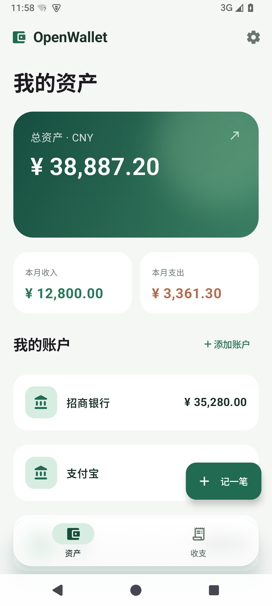
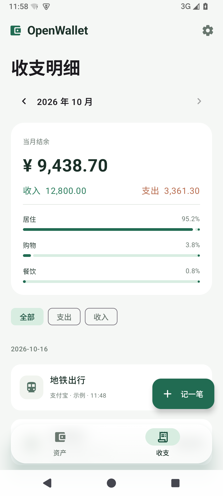
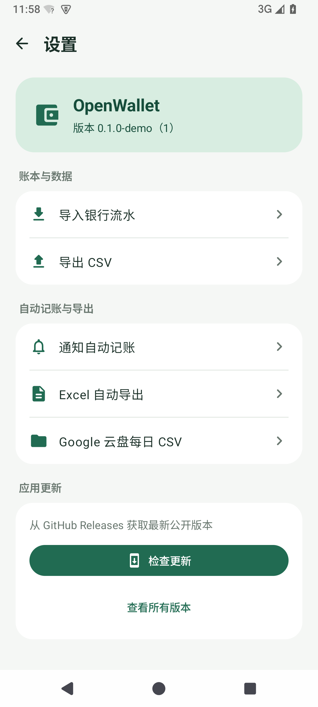
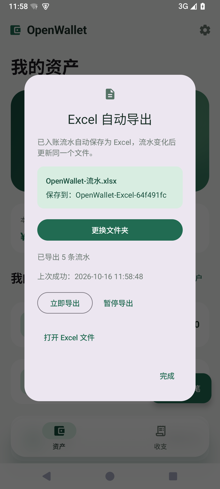

# OpenWallet

原生 Android 本地记账 demo。Kotlin + Jetpack Compose / Material 3，SQLite 持久化，无后端；支持手动 CSV 导出和本机 Excel 自动导出。

## 体验

安装 `app/build/outputs/apk/debug/app-debug.apk`（Android 8.0 / API 26 及以上）。首次打开可以添加自己的账户，也可以选择「体验示例账本」。示例不会自动写入已有账本。

- **资产**：总资产、各账户当前余额、本月收入和支出；点击账户校准当前余额。
- **收支**：按月浏览、收入/支出筛选、分类占比、明细和待确认通知。
- **记一笔**：选择账户，填写金额、交易方、分类和时间。
- **设置**：右上角齿轮进入独立页面，包含 CSV 导入/导出、通知自动记账、Excel 自动导出，以及当前版本与检查更新。支持页面返回和系统返回。

界面采用浅色 Material 3、绿色资产卡和悬浮毛玻璃底部导航。导航栏两侧留白，适配系统导航区；Android 12 及以上实时模糊栏后的页面，旧系统使用半透明背景。主账本保存在应用的 SQLite 数据库中，金额以整数分存储。Excel 自动导出默认关闭，选择本机文件夹后开启。

| 资产 | 收支 |
| --- | --- |
|  |  |

## 余额和去重

「当前余额」以**保存时刻**为基准。只有基准时刻之后的已确认流水影响该账户余额；之前的流水参与历史收支统计，但不会再次增减当前余额。再次校准余额会更新基准时刻，不删除历史流水。

- 同一账户、同一非空流水号：内容一致则跳过；金额、时间、方向或交易方不同则报冲突。
- 无流水号的相同交易，以及不同来源、同账户同金额同方向、相差不超过两分钟的交易：标记为疑似重复，默认不勾选。核对后可以保留两笔。
- 导入先预览、再确认；确认时重新检查，整批使用数据库事务。并发出现的新重复项不会因为旧预览而自动入账。
- 通知自动入账前缓冲 8 秒。同一事件重复投递会跳过；同一通知标识更新时间后仍会检查重复。微信/支付宝与银行在两分钟内的同额支出，即使映射到不同账户，也只先记一笔，其余通知折叠到该账目下核对。默认保留先入账通知的账户；确实是两次消费时可明确选择「另记一笔」。忽略的通知保留内部记录以避免重复出现，不影响余额。
- 点击已入账的通知记录可「移回待确认」，取消其对当前余额和收支统计的影响。

转账、退款关联、债务、多币种折算及各家银行原生文件格式尚未专门建模。本 demo 的统计适用于人民币收入/支出，不应把账户间转账同时当作真实收入和消费。

## 导入 CSV

先创建同名账户，再通过右上角「设置 → 导入银行流水」选择 UTF-8 CSV。支持 BOM、引号、字段内逗号和换行。每次最多 2 MB / 10000 条。

```csv
时间,账户,类型,金额,交易方,分类,流水号
2026-10-14 12:30:00,招商银行,支出,28.50,巷口咖啡,餐饮,bank-20261014-002
```

时间按设备本地时区解释，格式为 `yyyy-MM-dd HH:mm:ss`。金额填正数且最多两位小数；类型只能是「收入」或「支出」；流水号可空。专有银行 CSV 需先整理为上述列，暂不读取 PDF / XLSX。

仓库附带可选的 [账单转 CSV 技能](skills/bills-to-csv/SKILL.md)，用于在 Codex 中把表格、PDF、截图等来源整理为标准七列，再交给应用预览导入。技能中的 Python 脚本使用标准库校验格式、金额、账户名单和 CSV 往返；原始文件提取、OCR 与交易含义仍需逐项核对。

[样例流水](samples/bank-statement.csv) 包含一条重复流水，首次导入应选中 3 条。CSV 导出包含全部已入账记录，不包括通知候选；可重新导入，导出会转义电子表格公式前缀。

## 通知自动记账

在「设置 → 通知自动记账」开启「读取交易通知」，选择支付宝、微信或招商银行，并分别指定实际记入的账户、保存。通过「开启通知权限」进入 Android 系统授权页。

「直接入账」开启时，受支持标题下可识别且无重复迹象的交易先缓冲 8 秒，到期在数据库事务中重新检查后入账；关闭时，所有识别出的交易均待确认。缓冲期限保存在数据库，应用启动或通知监听重连会恢复处理；系统暂停进程可能延后执行。相同事件重复投递、改变账户映射后原样重放、已忽略事件原样重放都不会再次计入。同一通知标识更新时间时，同额同方向的新记录进入核对，避免绕过两分钟窗口再次自动扣账；通知标识可能被应用复用，因此保留人工确认真实新消费的入口。

两分钟内同账户的同额同方向通知，以及不同通知来源、不同账户的同额支出，会作为疑似同一笔处理。已有入账通知时，其余候选折叠在该记录的「多条通知 · 核对」入口下，不重复计入余额、月统计或导出。点「保留一笔」保留先入账项；只有明确勾选是另一笔交易后才能「另记一笔」。收入与支出、不同金额或跨账户的普通 CSV 记录不按这条跨通知规则合并。普通微信聊天、未选应用、验证码、失败/待付款/退款/转账类消息和无法确定金额或方向的通知会忽略。仅保存交易字段，不保存原始通知全文。

规则仍是实验性适配：本轮验证覆盖解析、设置到 SQLite 的记账链路和模拟器界面，尚未接收支付宝、微信或银行的真实通知进行端到端验证。系统权限需要在安装设备上手动开启。

## Excel 自动导出

在「设置 → Excel 自动导出」选择本机文件夹，应用会创建 `OpenWallet-流水.xlsx` 并持续更新同一文件，无需 Google 账户或联网。

手工记账、CSV 导入、通知入账与移回待确认均会安排导出；WorkManager 另以至少 15 分钟周期做后台补偿，实际执行时间由系统调度决定。设置中可立即导出、打开 Excel、暂停、继续或更换目录。旧 Google Sheets 后台任务在升级后停止，原有云端表格保留。

仅导出已入账流水，金额使用数值和两位小数格式，流水号按文本保留前导零与长编号。冻结表头并支持筛选。导出文件是账本快照，手动修改会在下一次导出时被覆盖；编辑前请先复制。使用说明与权限恢复见 [Excel 导出文档](docs/excel-export.md)，验证范围见 [验证记录](docs/verification.md)。

| 设置 | Excel 导出 |
| --- | --- |
|  |  |

## 云盘导出功能移除

Google 云盘每日 CSV 已移除。升级后会停止旧的周期与变更上传任务，已有云盘文件和本地账本保留。CSV 可继续手动导出，本机 Excel 导出不受影响。

## 检查更新

进入右上角「设置」，向下滚动到「应用更新」并点击「检查更新」。应用读取本仓库最新的公开正式 GitHub Release，以版本号判断是否有新版本，显示发布说明；点击「前往下载更新」会在浏览器中打开对应发布页。没有 APK 时显示「查看新版本」，同时提示尚未上传安装包。

无公开版本、网络超时、GitHub 限流和版本号无法识别分别提示，不会把检查失败当作已是最新。检查期间禁用重复请求，退出设置或旋转屏幕由 ViewModel 保留检查状态。「查看所有版本」可直接打开发布列表。此功能无需新增依赖、GitHub 登录或安装权限。

发布时的版本标签、APK 与签名要求见 [应用更新说明](docs/app-updates.md)。

[设置页截图](docs/screenshots/settings-update/settings.png)。本轮 APP 真实联网已收到 GitHub HTTP 403；电脑侧确认匿名 API 限流，尚未取得真实版本信息。详见 [验证记录](docs/verification.md)。

## 构建与测试

使用 JDK 21、Android SDK 36 / Build Tools 36.0.0；AGP 8.13.2、Kotlin 2.2.20、Gradle 8.14。依赖仅来自 Google Maven、Maven Central 与 Gradle Plugin Portal，版本固定，依赖锁随项目保留。

在未跟踪的 `local.properties` 中填写 `sdk.dir`，然后运行：

```powershell
$env:JAVA_HOME = 'D:\AndroidStudio\jbr' # 按本机安装位置调整
.\gradlew.bat --max-workers=2 assembleDebug testDebugUnitTest lintDebug
.\gradlew.bat --max-workers=2 connectedDebugAndroidTest
```

第二条命令需要一个已启动的模拟器或已授权的测试设备。测试包括金额精度、CSV 往返、去重、通知解析，以及 SQLite 余额、事务回滚、通知确认和界面操作。构建测试的实际结果参见 [验证记录](docs/verification.md)。

设备测试与界面测试使用独立的临时数据库，结束后关闭并删除；通知测试的临时设置也会清理。界面测试通过注入测试账本操作同一套页面，不向日常账本写入 mock。截图保留在文档中供查看。

Windows 如需使用现有 HTTP 代理，可在命令中追加 `-Dhttps.proxyHost=127.0.0.1 -Dhttps.proxyPort=7897`，按本机实际设置填写；不需要修改系统代理或关闭 TLS 检查。

## Android Studio MCP

使用 JetBrains 官方 MCP Server 插件，已为当前机器配置 Codex 的 `android-studio` 服务。支持普通 IDE 和无界面启动；具体路径、启动方法、已验证的调用见 [MCP 配置记录](docs/android-studio-mcp.md)。

## 参考

实现前检索并查看了 [expense-tracker-android](https://github.com/furqanullah717/expense-tracker-android) 的 Kotlin / Compose / Room 记账架构，以及 [JetBrains MCP 官方项目](https://github.com/JetBrains/mcp-jetbrains)。通知用语和商户规则参考并改编自 [seamless-bookkeeping](https://github.com/DykiSensei/seamless-bookkeeping)，保留其 [MIT 许可](THIRD_PARTY_NOTICES.md)。数据库直接使用 Android SQLiteOpenHelper，金额、去重、入账链路和界面由本仓库实现，未整库复制。
