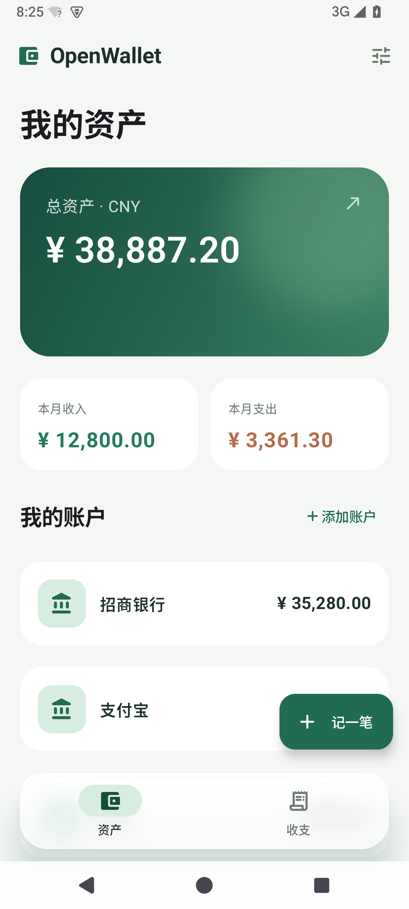

# OpenWallet

原生 Android 本地记账 demo。Kotlin + Jetpack Compose / Material 3，SQLite 持久化，无后端；可选连接 Google Sheets 自动导出。

## 体验

安装 `app/build/outputs/apk/debug/app-debug.apk`（Android 8.0 / API 26 及以上）。首次打开可以添加自己的账户，也可以选择「体验示例账本」。示例不会自动写入已有账本。

- **资产**：总资产、各账户当前余额、本月收入和支出；点击账户校准当前余额。
- **收支**：按月浏览、收入/支出筛选、分类占比、明细和待确认通知。
- **记一笔**：选择账户，填写金额、交易方、分类和时间。
- **账本工具**：CSV 导入、CSV 导出、通知自动记账设置、Google Sheets 自动导出。

界面采用浅色 Material 3、绿色资产卡和悬浮毛玻璃底部导航。导航栏两侧留白，适配系统导航区；Android 12 及以上实时模糊栏后的页面，旧系统使用半透明背景。主账本保存在应用的 SQLite 数据库中，金额以整数分存储。Google Sheets 默认关闭，授权启用后会上传已入账流水。

| 资产 | 收支 |
| --- | --- |
|  |  |

## 余额和去重

「当前余额」以**保存时刻**为基准。只有基准时刻之后的已确认流水影响该账户余额；之前的流水参与历史收支统计，但不会再次增减当前余额。再次校准余额会更新基准时刻，不删除历史流水。

- 同一账户、同一非空流水号：内容一致则跳过；金额、时间、方向或交易方不同则报冲突。
- 无流水号的相同交易，以及不同来源、同账户同金额同方向、相差不超过两分钟的交易：标记为疑似重复，默认不勾选。核对后可以保留两笔。
- 导入先预览、再确认；确认时重新检查，整批使用数据库事务。并发出现的新重复项不会因为旧预览而自动入账。
- 通知可直接入账或先待确认。同一事件重复投递会跳过；疑似重复、来源标题不明确的交易进入待确认。忽略的通知保留内部记录以避免重复出现，不影响余额。
- 点击已入账的通知记录可「移回待确认」，取消其对当前余额和收支统计的影响。

转账、退款关联、债务、多币种折算及各家银行原生文件格式尚未专门建模。本 demo 的统计适用于人民币收入/支出，不应把账户间转账同时当作真实收入和消费。

## 导入 CSV

先创建同名账户，再通过右上角「账本工具 → 导入银行流水」选择 UTF-8 CSV。支持 BOM、引号、字段内逗号和换行。每次最多 2 MB / 10000 条。

```csv
时间,账户,类型,金额,交易方,分类,流水号
2026-10-14 12:30:00,招商银行,支出,28.50,巷口咖啡,餐饮,bank-20261014-002
```

时间按设备本地时区解释，格式为 `yyyy-MM-dd HH:mm:ss`。金额填正数且最多两位小数；类型只能是「收入」或「支出」；流水号可空。专有银行 CSV 需先整理为上述列，暂不读取 PDF / XLSX。

仓库附带可选的 [账单转 CSV 技能](skills/bills-to-csv/SKILL.md)，用于在 Codex 中把表格、PDF、截图等来源整理为标准七列，再交给应用预览导入。技能中的 Python 脚本使用标准库校验格式、金额、账户名单和 CSV 往返；原始文件提取、OCR 与交易含义仍需逐项核对。

[样例流水](samples/bank-statement.csv) 包含一条重复流水，首次导入应选中 3 条。CSV 导出包含全部已入账记录，不包括通知候选；可重新导入，导出会转义电子表格公式前缀。

## 通知自动记账

在「账本工具 → 通知自动记账」开启「读取交易通知」，选择支付宝、微信或招商银行，并分别指定实际记入的账户、保存。通过「开启通知权限」进入 Android 系统授权页。

「直接入账」开启时，受支持标题下可识别且无重复迹象的交易直接进入账本；关闭时，所有识别出的交易均待确认。相同事件重复投递、改变账户映射后重放、已忽略事件重放都不会再次计入。不同事件若在两分钟内同账户、同金额、同方向，则作为疑似重复待确认。普通微信聊天、未选应用、验证码、失败/待付款/退款/转账类消息和无法确定金额或方向的通知会忽略。仅保存交易字段，不保存原始通知全文。

规则仍是实验性适配：本轮验证覆盖解析、设置到 SQLite 的记账链路和模拟器界面，尚未接收支付宝、微信或银行的真实通知进行端到端验证。系统权限需要在安装设备上手动开启。

## Google Sheets 自动导出

在「账本工具 → Google Sheets 自动导出」填写设备上的目标 Google 邮箱，点击「连接并开启」并完成 Google 授权。应用会在该账户自己的 Drive 中创建「OpenWallet 自动导出」表格，后续持续更新同一张表。首次使用前需完成 [Google Cloud 配置](docs/google-sheets.md)。

手工记账、CSV 导入、通知入账与移回待确认均会安排导出；WorkManager 另以 15 分钟为最短周期做后台补偿，实际执行时间由系统与联网状态决定。设置中可以立即导出、打开表格、暂停或更换账户。暂停保留已有云端表格；不同账户各自保存导出目标。

只包含已入账流水，不上传待确认/忽略的通知或原始通知正文。导出工作表的 A:I 是应用管理的快照区域，手动修改会在下一次导出时被覆盖；分析公式请放在其他工作表。金额和流水号按文本写入以保留精度及前导零。尚未完成真实 Google 账户授权及云端写入验收，本地测试范围见 [验证记录](docs/verification.md)。

## 构建与测试

使用 JDK 21、Android SDK 36 / Build Tools 36.0.0；AGP 8.13.2、Kotlin 2.2.20、Gradle 8.14。依赖仅来自 Google Maven、Maven Central 与 Gradle Plugin Portal，版本固定，依赖锁随项目保留。

在未跟踪的 `local.properties` 中填写 `sdk.dir`，然后运行：

```powershell
$env:JAVA_HOME = 'D:\AndroidStudio\jbr' # 按本机安装位置调整
.\gradlew.bat --max-workers=2 assembleDebug testDebugUnitTest lintDebug
.\gradlew.bat --max-workers=2 connectedDebugAndroidTest
```

第二条命令需要一个已启动的模拟器或已授权的测试设备。测试包括金额精度、CSV 往返、去重、通知解析，以及 SQLite 余额、事务回滚、通知确认和界面操作。构建测试的实际结果参见 [验证记录](docs/verification.md)。

设备测试与界面测试使用独立的临时数据库，结束后关闭并删除；通知测试的临时设置也会清理。界面测试通过注入测试账本操作同一套页面，不向日常账本写入 mock。截图保留在文档中供查看。

Windows 如需使用现有 HTTP 代理，可在命令中追加 `-Dhttps.proxyHost=127.0.0.1 -Dhttps.proxyPort=7897`，按本机实际设置填写；不需要修改系统代理或关闭 TLS 检查。

## Android Studio MCP

使用 JetBrains 官方 MCP Server 插件，已为当前机器配置 Codex 的 `android-studio` 服务。支持普通 IDE 和无界面启动；具体路径、启动方法、已验证的调用见 [MCP 配置记录](docs/android-studio-mcp.md)。

## 参考

实现前检索并查看了 [expense-tracker-android](https://github.com/furqanullah717/expense-tracker-android) 的 Kotlin / Compose / Room 记账架构，以及 [JetBrains MCP 官方项目](https://github.com/JetBrains/mcp-jetbrains)。通知用语和商户规则参考并改编自 [seamless-bookkeeping](https://github.com/DykiSensei/seamless-bookkeeping)，保留其 [MIT 许可](THIRD_PARTY_NOTICES.md)。数据库直接使用 Android SQLiteOpenHelper，金额、去重、入账链路和界面由本仓库实现，未整库复制。
